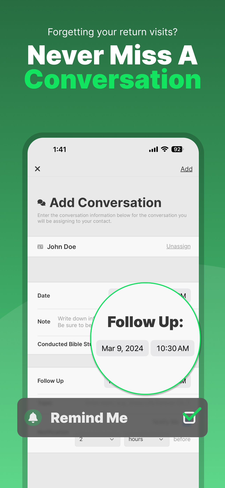
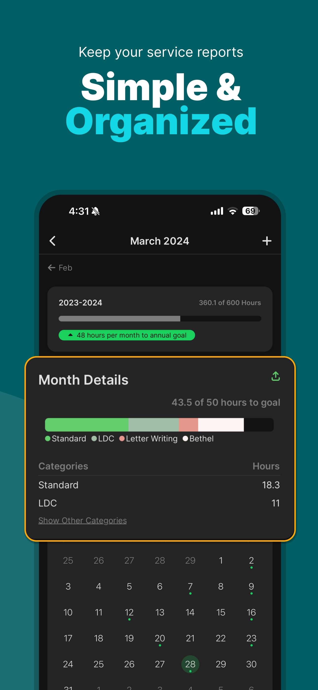
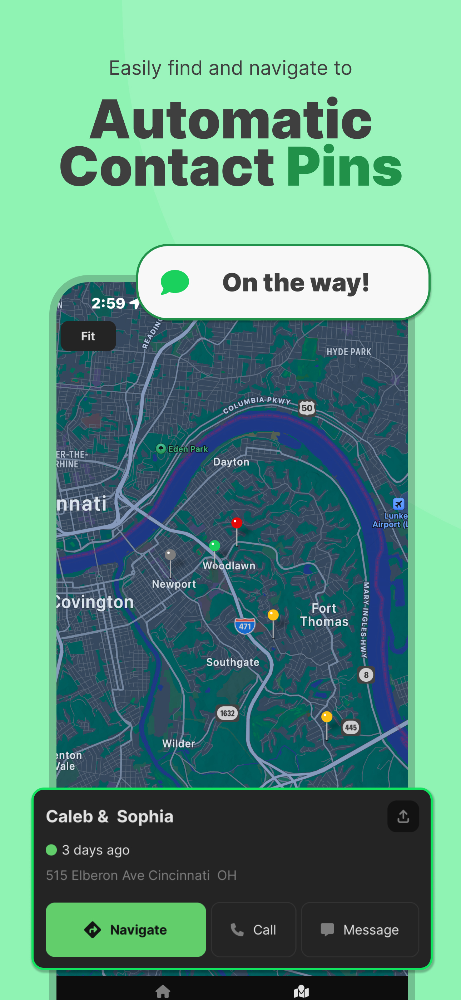
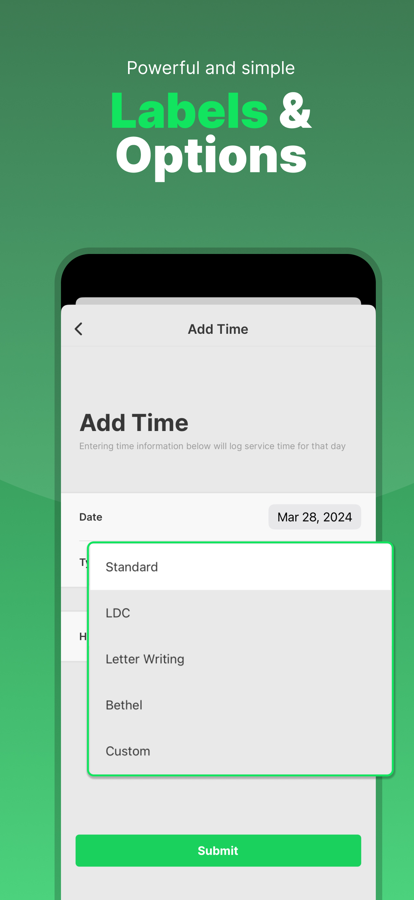
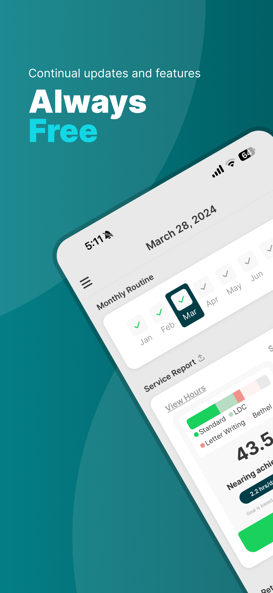
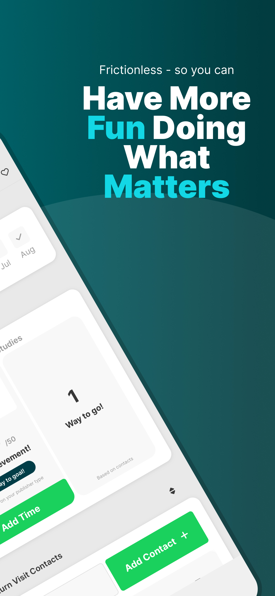
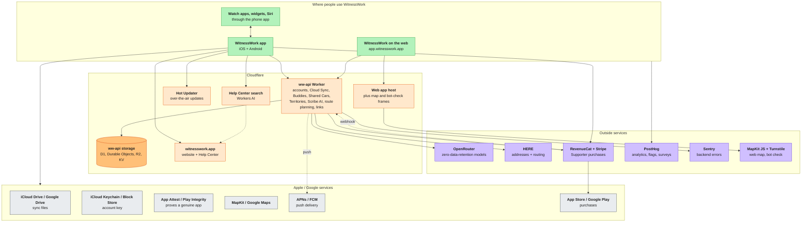

# WitnessWork

WitnessWork is the easy way for Jehovah's Witnesses to manage their field service priorities.

It's available on iOS, Android, and the web, built in TypeScript with React Native and Expo.

## Sponsor

Please consider donating if you have found WitnessWork helpful to you in your service & you have the means.

## View it live

## Languages 🌐

WitnessWork is available in 19 languages, translated with AI, including Arabic with a right-to-left layout. If a translation looks wrong, please [open an issue](https://github.com/leviFrosty/witness-work/issues/new) with the language, the screen, and the correct wording. Thank you!

## Building

Development setup (iOS and Android) and the production build process are documented in [docs/build.md](./docs/build.md). Production builds are intentionally done **locally** (`pnpm run build:prod-auto-submit`) rather than on EAS Build cloud services.

## Architecture

How the app, its backend [ww-api](https://github.com/leviFrosty/ww-api), and the services they use connect. Arrows point from the caller to what it calls; dashed arrows are pushes and background work.

[Open the diagram in Mermaid Live](https://mermaid.live/view#pako:eNp9Vm1T4zYQ_isa35c2KBQYKCTT6YxJQsnxkkzsO8qcOyDb60SNY3kkmTS9u__eleQkduEYPsRa6Vnt7vPsiq9eIlLw-l6Wi3WyYFKT8DIqCFFVPJesXJDB7Xh0HwZfIu9hARJICaLMgVQKyAPXBSj1IOQy8v4yKEL86RSPPnc6jU3CyrLTiQo-CcgB8YtUCp4-7yAPo8vXEFEQvQCyhtgg0cHh2u2ucfcQ13v86M9w5ge1C6aThblPUbLm6Rw0fgRccuNFL6So5gvruFyIAkjDDxRpVLQyn9764dVkdoee_dLk_Av5Q4g5fiiQLzwBtQth-hQ83g9cCHyQiyolQ8lfGhC7NEGoTZGQjOegnhvwm9Fj0ILfwAbp4AV6uMxFsiSBFtI6YEkiqkKTJWyaHvwwHAWh84HhEl9rUBrh05xtyLjQMJdcb4yHUooXUISRORQVb5fBuLrzp3Uwd6y84XqfBa5Vp9M8O_0UXNeXTu8Vnrwa3Nk7KrUgKeSYtWzFGYST2Wgfpk1rf4EJ1sElpq_2RXpNz-AKvdhiZTmT0FDg2Llfr7us5MTICWSjcqgIV-MAqaDkskpTDkYmKH9IyYBJRaMiBIn1EtJtJZLHQPwxJSghjfLJWVHwYk5Jzotlg8qhH_pffmrer9AJm1vqhseUDCvJYsx0Ev8NiYlldkLJzWf08HPtYoIerINrocmnMmXahY-kyS5qt8u4JJW1q1YXXU-2AniA2JBKFkJpW868UmTFSsKKlMRCd5MFoKYyyVZNH8E4rKn5X7MZH9iKimPqB-Qa8pIMACUlG9iRPxvUUmgcwF5hSKVx4IhQWMUfk4q9PJrd-7foZ1JpxdM3mi14ur29cxdNSihmhhBboH9Bii6WhXUlaLyd4xBZ4XjLmyk-XY-2-jNfVhdpKjFZbIkDSy_y2gTM6saewQv2CwyYxnOBlry0pAZVWQppUn0lWoOe1jWZIhXXYm7vK1i-0TxB8lG6c_xRlXyBTQsX4NSdPTpsgMlI2xcxS5ZYNYLiFLJ1HvkPPg9abfvRjNuwkoXSOG9qDo0MqNEAsRp4RYWbpuS3bvd3M8yNCX-IW47NEm96a1kLsAlAJTeXRl6ttZWMsbgv0j1849R2DBtb_Rg5NJa25Q2JquMxcdQ2VxZ3bmxtpkObayuntsEIo22ZDdprx87OhnF_izwz8yLvWz0VbV4IdEm4ube3OQTysRBiaUC2mmY_yZlSQ8jwgyPv5q3I-x_ik-wkjqnSUiyh_-Ek68HpKU1ELmT_wzGYvxYYB5TOhFzVcOhBAtkOfto7Ozo7fwe-tr1ag7MMLpJkB4aLs95R8g5YaRxNO2xydH6xw6a904uj7B0s_IOdhP1Rw9OjOMv2cf96fnqc9n4AN0qgyDetJezqt992jzR1jy3dvpjUvXfUkUZronb1a3ofUxQ0rfVFjU5pLVxXrv1ZozFXhr3N6ow6cVEjAmoUTLdaolut7koQFR71ViBXjKf4H9rXyMPhv8KHrh95KWSsynXkfcczrNLCvGVeX8sKqOfehiFnOFNXzvj9P-cDKOo) to zoom and pan.

## License

WitnessWork © 2023-2026 by Levi Wilkerson is licensed under [Attribution-NonCommercial 4.0 International](./LICENSE)
