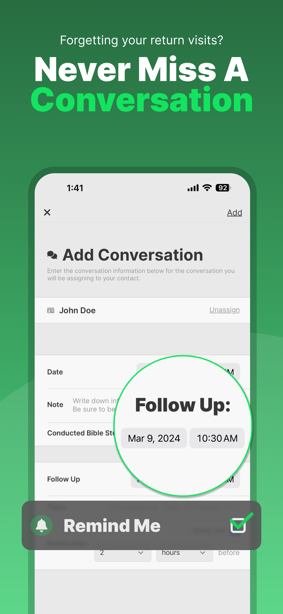
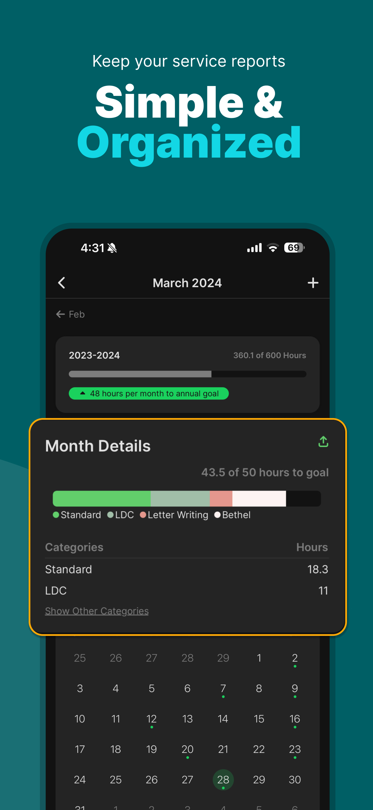
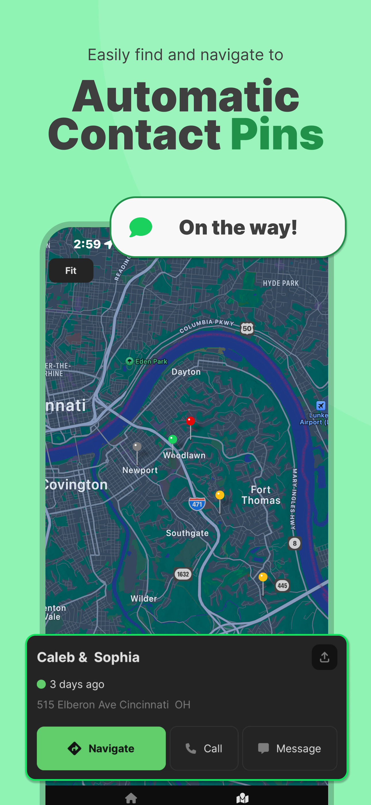
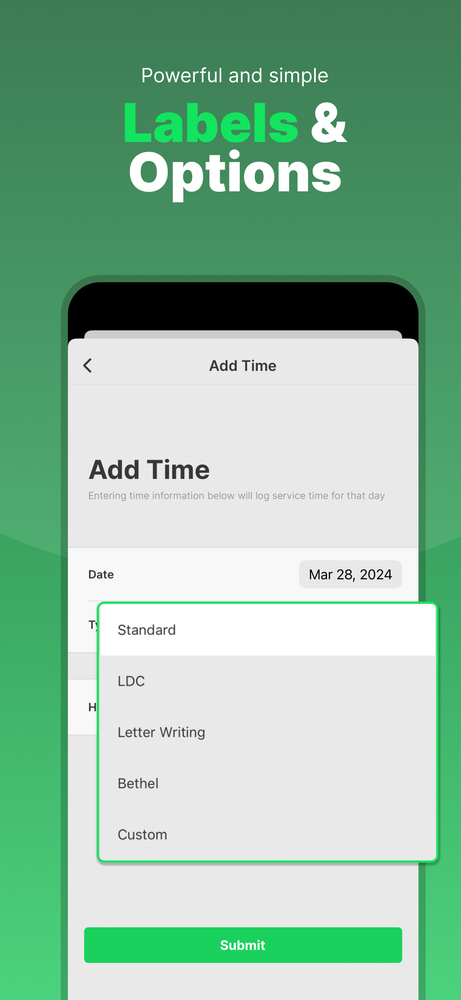
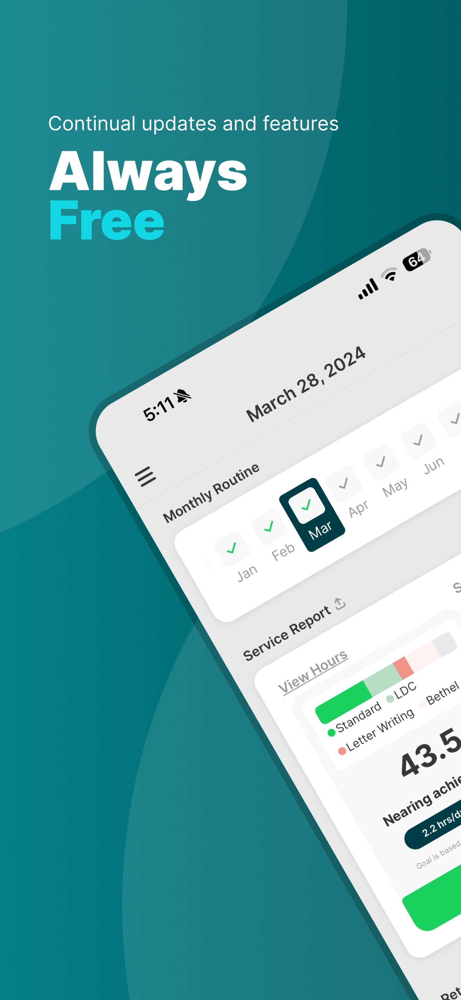
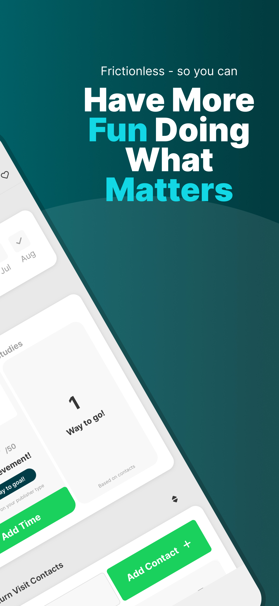

# WitnessWork

WitnessWork is the easy way for Jehovah's Witnesses to manage their field service priorities.

It is written in Typescript using React Native and Expo and is available on iOS and Android.

## Sponsor

Please consider donating if you have found WitnessWork helpful to you in your service & you have the means.

## Looking for maintainers

Due to my increased time constraints volunteering, my day job, family, etc., I'm looking for someone to take the lead in bug fixes + future development on this project for the foreseeable future. Please contact me at <levi@leviwilkerson.com>.

## View it live

## Languages 🌐

WitnessWork is available in 19 languages, translated with AI, including Arabic with a right-to-left layout. If a translation looks wrong, please [open an issue](https://github.com/leviFrosty/witness-work/issues/new) with the language, the screen, and the correct wording. Thank you!

## Building

Development setup (iOS and Android) and the production build process are documented in [docs/build.md](./docs/build.md). Production builds are intentionally done **locally** (`pnpm run build:prod-auto-submit`) rather than on EAS Build cloud services.

## Architecture

How the app, its backend [ww-api](https://github.com/leviFrosty/ww-api) (a Cloudflare Worker), and the services they call connect. Arrows point from the caller to what it calls or reads, and dashed arrows are pushes and background work. "A / B" boxes name the iOS / Android pair that does the same job, such as App Attest / Play Integrity.

```mermaid
flowchart LR
  %% WitnessWork architecture, high level.
  %% Arrows point from the caller to what it calls or reads. Dashed arrows are pushes and background work.
  %% "A / B" boxes are the iOS / Android pair for the same job.

  subgraph DEVICE["Other surfaces on the device"]
    C_WIDGETS["`**iOS widgets, Live Activity**
read a snapshot, App Group`"]
    C_SIRI["`**Siri + Shortcuts (iOS)**
queue drafts, App Group`"]
    C_WATCH["`**Apple Watch app**
via WatchConnectivity`"]
    C_WEAR["`**Wear OS app**
via Wearable Data Layer`"]
    C_NSE["`**iOS notification extension**
names Buddies alerts`"]
  end

  subgraph APP["WitnessWork app"]
    A_LOCAL[("`**On-device data**
Zustand stores in MMKV + files`")]
    A_CORE["`**Field service core, local only**
time, reports, plans, Assistant
progress, badges, mileage`"]
    A_BUDDIES["`**Buddies**
end-to-end encrypted sharing`"]
    A_ACCOUNT["`**Account**
anonymous account, recovery key,
Set Up Another Device, backup`"]
    A_SYNC["`**Sync + backups**
one option per device: Cloud Sync,
iCloud / Google Drive, or off`"]
    A_SCRIBE["`**Scribe AI**
on-device voice + photo text,
tools run on the phone`"]
    A_ROUTE["`**Route planning**
Supporter only`"]
    A_CONTACTS["`**Contacts, visits + map**
addresses and pins`"]
    A_LINKS["`**Share links**
contacts, Buddies invites`"]
    A_SUPPORTER["`**Supporter + paywall**
purchases and entitlements`"]
    A_SHELL["`**App shell**
analytics, flags, surveys, OTA`"]
    A_HELP["`**Help Center**
offline snapshot + downloaded bundle`"]
  end

  subgraph PLATFORM["Apple / Google platform services"]
    P_CAL["`**Device calendar**
EventKit / CalendarContract`"]
    P_SEED["`**iCloud Keychain / Block Store**
account key (Buddies root seed)`"]
    P_SYNC["`**iCloud Drive / Google Drive**
sync files + photos`"]
    P_ATTEST["`**App Attest / Play Integrity**
proves a genuine app`"]
    P_MAPS["`**MapKit / Google Maps SDK**
maps, place search, iOS directions`"]
  end

  P_PUSH["`**APNs / FCM**
push delivery`"]

  W_BROWSER["`**WitnessWork on the web**
the same app in a browser`"]

  subgraph CF["Cloudflare"]
    S_OTA["`**Hot Updater Workers**
separate dev / beta / prod`"]
    D_OTA[("`**D1 databases**
release catalogs + operational reports`")]
    B_OTA[("`**Private R2 buckets**
signed JavaScript + assets`")]
    S_WEB["`**Web app Workers**
static files, headers, CSP reports
separate dev / beta / prod`"]
    S_OTA --> D_OTA
    S_OTA -->|"signed downloads"| B_OTA
    subgraph WORKER["ww-api Worker"]
      R_BUD["`**/buddies/v1/...**
signed ops, live WebSocket, photos`"]
      R_SCRIBE["`**/scribe/v1/...**
status, usage, step SSE, transcribe`"]
      R_ROUTE["`**POST /route-planning/optimize, /directions**
coordinates only`"]
      R_PLACES["`**GET /geocode, /autocomplete**
HERE proxy, key stays server-side`"]
      R_ACC["`**/accounts/v1/...**
attested sessions, bearer ops,
handoff relay, encrypted backups,
Cloud Sync slots + photos + live WebSocket,
RevenueCat link + Supporter status`"]
      R_RCHOOK["`**POST /revenuecat/v1/webhook**
keeps Supporter status current`"]
      R_ATTEST["`**/attestation/v1/...**
status, challenges, App Attest key setup`"]
      R_APPCFG["`**GET /app/v1/config**
minimum app version, sync switches`"]
      R_LINKS["`**GET /c, /b, /h, /.well-known**
link pages, Universal + App Links`"]
      R_RATINGS["`**GET /app-store/ratings**
paywall social proof`"]
      CRON["`**Hourly cron**
App Store ratings sweep, pruning`"]
    end
    subgraph BUD_STATE["Buddies relay state"]
      DO_REGQ[("`**BuddyRegistrationQuota DO**
registrations per caller`")]
      DO_INV[("`**BuddyInvite DO**
one per invite, 7-day expiry`")]
      DO_INBOX[("`**BuddyInbox DO**
one per inbox, sealed data`")]
      R2[("`**R2: ww-buddy-blobs**
sealed photos, 90 days max`")]
    end
    subgraph AT_STATE["Attestation state"]
      DO_AA[("`**AppAttestIdentity DO**
attested key per iOS install`")]
      DO_PI[("`**PlayIntegrityChallenges DO**
one-time Android challenges`")]
    end
    DO_METER[("`**ScribeMeter DO**
usage windows per account`")]
    subgraph ACC_STATE["Account state"]
      D_ACC[("`**D1: accounts**
account ids, public keys, inbox links,
sessions, linked RevenueCat customers`")]
      DO_HANDOFF[("`**AccountHandoff DO**
one per handoff, 10 minutes`")]
      R2_BACKUP[("`**R2: ww-account-backups**
sealed slot per device, 400 days idle`")]
      DO_SYNC[("`**AccountSync DO**
one per account: slot and photo index,
sync sockets, limits, photo purge`")]
      R2_SYNC[("`**R2: ww-account-sync**
sealed sync slot per device`")]
      R2_PHOTOS[("`**R2: ww-account-photos**
sealed Cloud Sync photos, up to 2 GB an account`")]
    end
    subgraph HELP["Help Center search"]
      S_HELPS["`**ww-help-search Worker**
GET /v1/search, cron content sync`"]
      AIS[("`**Workers AI + KV**
embeddings, keyword index by locale`")]
    end
    S_SITE["`**ww-marketing (witnesswork.app)**
static site: Help Center pages + JSON bundles`"]
    DO_RPQ[("`**RoutePlanningQuota DO**
route and directions quotas per account`")]
    KV[("`**Workers KV: NOTES_KV**
switches, limits, tokens, ratings`")]
  end

  subgraph EXTERNAL["External services"]
    S_GPI["`**Play Integrity API (Google)**
decodes Android verdicts`"]
    S_OR["`**OpenRouter**
LLM gateway`"]
    S_LLM["`**Azure via OpenRouter**
(zero data retention)`"]
    S_HERE["`**HERE location APIs**
geocode, autocomplete, sequence`"]
    P_STORE["`**App Store / Google Play**
purchases, App Store ratings`"]
    S_SENTRY["`**Sentry**
Worker errors + traces`"]
    S_RC["`**RevenueCat**
Supporter entitlements, web checkout pages`"]
    S_STRIPE["`**Stripe**
card payments for web checkout`"]
    S_PH["`**PostHog**
analytics, flags, surveys, errors`"]
  end

  C_WIDGETS --> A_LOCAL
  C_SIRI --> A_LOCAL
  C_WATCH <--> A_LOCAL
  C_WEAR <--> A_LOCAL
  C_NSE -->|"inbox/sync"| R_BUD

  A_CORE -->|"Follow-ups as events"| P_CAL
  A_BUDDIES -->|"root seed"| P_SEED
  A_SYNC -->|"iCloud / Drive: sync files + photos"| P_SYNC
  A_SYNC -->|"Cloud Sync: account session"| A_ACCOUNT
  A_SYNC -->|"Cloud Sync: bearer: sealed snapshots + photos, WebSocket"| R_ACC
  A_ACCOUNT -->|"attest device"| P_ATTEST
  A_CONTACTS -->|"maps, place search"| P_MAPS
  A_SHELL -->|"fingerprint-compatible OTA"| S_OTA
  W_BROWSER -->|"app files, CSP reports"| S_WEB

  A_BUDDIES -->|"signed ops, WebSocket"| R_BUD
  A_ACCOUNT -->|"account key"| P_SEED
  A_ACCOUNT -->|"open session, sealed handoff, sealed backup, RevenueCat id"| R_ACC
  A_ACCOUNT -->|"status, key setup, session challenge"| R_ATTEST
  A_SHELL -->|"minimum version"| R_APPCFG
  A_SCRIBE -->|"account session"| A_ACCOUNT
  A_SCRIBE -->|"bearer: conversation + tools, SSE per step"| R_SCRIBE
  A_ROUTE -->|"account session"| A_ACCOUNT
  A_ROUTE -->|"bearer: today's stops"| R_ROUTE
  A_ROUTE -->|"directions (iOS)"| P_MAPS
  A_CONTACTS -->|"address lookup"| R_PLACES
  A_LINKS -->|"/c, /b and /h links"| R_LINKS
  A_SUPPORTER -->|"paywall ratings"| R_RATINGS
  A_SUPPORTER -->|"purchases, RevenueCat SDK, web checkout links"| S_RC
  A_SHELL -->|"events, flags, surveys, errors"| S_PH
  A_HELP -->|"manifest + locale bundle"| S_SITE
  A_HELP -->|"search query, locale, platform"| S_HELPS

  R_BUD -->|"register"| DO_REGQ
  R_BUD -->|"invite claims"| DO_INV
  R_BUD -->|"RPC + WebSocket"| DO_INBOX
  R_BUD -->|"photo reads"| R2
  R_BUD -->|"inbox links"| D_ACC
  R_ACC -->|"accounts"| D_ACC
  R_ACC -->|"handoff channel"| DO_HANDOFF
  R_ACC -->|"backup slots"| R2_BACKUP
  R_ACC -->|"sync index, WebSocket"| DO_SYNC
  R_ACC -->|"sync slots"| R2_SYNC
  DO_SYNC -.->|"retention sweep"| R2_SYNC
  R_ACC -->|"sync photos"| R2_PHOTOS
  DO_SYNC -.->|"photo purge"| R2_PHOTOS
  R_ACC -->|"iOS assertion"| DO_AA
  R_ACC -->|"Android verdict"| S_GPI
  R_ATTEST -->|"iOS keys, challenges"| DO_AA
  R_ATTEST -->|"Android challenge"| DO_PI
  DO_INBOX <-->|"invites"| DO_INV
  DO_INBOX -->|"photo writes"| R2
  R_SCRIBE -->|"usage windows"| DO_METER
  R_ROUTE -->|"daily quota"| DO_RPQ
  R_ROUTE -->|"Supporter status"| D_ACC
  R_SCRIBE -->|"Supporter status"| D_ACC
  R_RCHOOK -->|"customer records"| D_ACC
  R_RATINGS -->|"cached ratings"| KV
  CRON -->|"writes ratings"| KV
  WORKER -.->|"flags, limits, tokens"| KV

  R_BUD -.->|"push"| P_PUSH
  P_PUSH -.->|"iOS alert"| C_NSE
  P_PUSH -.->|"Android data push"| A_BUDDIES
  R_SCRIBE -->|"model steps (streamed) and page reads, ZDR hosts only"| S_OR
  S_OR --> S_LLM
  R_ROUTE -->|"waypoint sequence, routing"| S_HERE
  R_PLACES -->|"geocode, autocomplete"| S_HERE
  CRON -->|"ratings lookup"| P_STORE
  S_RC -->|"store receipts"| P_STORE
  S_RC -->|"web payments (RevenueCat Billing)"| S_STRIPE
  WORKER -->|"reads customers (REST)"| S_RC
  S_RC -.->|"webhook events"| R_RCHOOK
  WORKER -->|"usage events"| S_PH
  WORKER -->|"errors + traces"| S_SENTRY
  S_HELPS -->|"embeddings + index"| AIS
  S_HELPS -.->|"pulls changed answers"| S_SITE

  classDef device fill:#99e9f2,stroke:#0c8599,color:#1e1e1e
  classDef app fill:#b2f2bb,stroke:#2f9e44,color:#1e1e1e
  classDef local fill:#ffec99,stroke:#f08c00,color:#1e1e1e
  classDef platform fill:#e9ecef,stroke:#495057,color:#1e1e1e
  classDef worker fill:#ffe8cc,stroke:#e8590c,color:#1e1e1e
  classDef state fill:#ffc078,stroke:#d9480f,color:#1e1e1e
  classDef external fill:#d0bfff,stroke:#6741d9,color:#1e1e1e
  class C_WIDGETS,C_SIRI,C_WATCH,C_WEAR,C_NSE device
  class A_CORE,A_BUDDIES,A_ACCOUNT,A_SYNC,A_SCRIBE,A_ROUTE,A_CONTACTS,A_LINKS,A_SUPPORTER,A_SHELL,A_HELP app
  class A_LOCAL local
  class P_CAL,P_SEED,P_SYNC,P_ATTEST,P_MAPS,P_PUSH,P_STORE,S_GPI platform
  class R_BUD,R_ACC,R_RCHOOK,R_ATTEST,R_APPCFG,R_SCRIBE,R_ROUTE,R_PLACES,R_LINKS,R_RATINGS,CRON,S_HELPS,S_SITE worker
  class DO_REGQ,DO_INV,DO_INBOX,R2,D_ACC,DO_HANDOFF,R2_BACKUP,DO_SYNC,R2_SYNC,DO_AA,DO_PI,DO_METER,DO_RPQ,KV,AIS state
  class S_OR,S_LLM,S_HERE,S_SENTRY,S_RC,S_STRIPE,S_PH,S_EAS external
```

- ww-api runs as one Cloudflare Worker, `ww-proxy`, at `ww-proxy.leviwilkerson.com`. The dev Worker, `ww-proxy-dev`, has its own KV namespace, Durable Objects, and R2 buckets.
- Buddies cards, events, and photos are sealed on the device before they reach the relay. [docs/buddies-protocol.md](./docs/buddies-protocol.md) lists what the relay can see.
- Account backups are sealed on the device with a key only the User's devices can derive; the server keeps each device's ciphertext, its size and upload time ([docs/accounts-protocol.md](./docs/accounts-protocol.md#backup)).
- Each device syncs through one option ([ADR 0030](./docs/adr/0030-cloud-sync-through-ww-api.md)). Cloud Sync, the default, works across iOS and Android: each device's snapshot is sealed with the account's sync key before it reaches ww-api, and the account's sync socket tells its other devices to pull. iCloud and Google Drive sync stay available, and devices sync only with devices on the same option ([docs/icloud-sync.md](./docs/icloud-sync.md)).
- Scribe AI reaches its model through OpenRouter, pinned to zero-data-retention hosts ([ADR 0008](./docs/adr/0008-notes-import-third-party-llm-zero-retention.md)). Its tools run on the phone: each model step is one bearer request on the account's attested session ([ADR 0027](./docs/adr/0027-account-sessions-attest-once-then-bearer-tokens.md)) carrying the conversation, and ww-api keeps only usage records ([ADR 0032](./docs/adr/0032-scribe-ai-agent-harness.md), [docs/scribe-ai-protocol.md](./docs/scribe-ai-protocol.md)). The old `/notes-import/...` routes answer 426 Update Required, except the status probe older app versions still read.
- Supporter status lives on the server account ([ADR 0029](./docs/adr/0029-supporter-status-on-the-server-account.md)): the app names the RevenueCat customer it's logged in as, ww-api reads that customer from RevenueCat itself, and RevenueCat's webhook keeps the record current. Legacy route planning still asks RevenueCat about the id it sends.
- The Help Center's content lives in this repo's website, `services/marketing`, a static site on Workers Static Assets published at `witnesswork.app/help` ([ADR 0033](./docs/adr/0033-help-center-on-the-website.md), [ADR 0042](./docs/adr/0042-witnesswork-app-domain.md), [docs/help-center.md](./docs/help-center.md)); the old `leviwilkerson.com/witness-work/…` addresses shipped builds use redirect there. The app ships a snapshot, downloads a newer bundle when the Help Center opens, and searches on the device when the `help-search` Worker (`services/help-search`) can't answer. Search requests carry the typed query, language, platform and app version, and no account or device identifier.
- Left out: `GET /health` (the app checks its clock against it), the admin reset route, the private CloudKit record that picks which iPhone publishes Follow-ups to the calendar, link previews the device fetches for URLs in notes, and the build and release pipeline.

When a change adds, removes, or reroutes one of these connections, update the diagram in the same pull request.

## License

WitnessWork © 2023-2026 by Levi Wilkerson is licensed under [Attribution-NonCommercial 4.0 International](./LICENSE)
